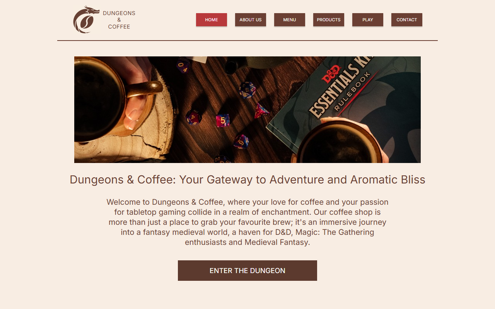

# Dungeons & Coffee (original version)

A university project: a website for a fictional coffee shop and tabletop gaming café themed around Dungeons & Dragons and Magic: The Gathering. This is the original coursework version; the redesign is in [dungeons-and-coffee](https://github.com/RodrigoPerez2803/dungeons-and-coffee).

**Live site:** https://rodrigoperez2803.github.io/dungeons-and-coffee-original/

## What it covers

- A multi-page static site: home, about, menu, products, play and contact.
- Semantic HTML with hand-written CSS, and a small script for switching between the product categories.

Open `index.html` in a browser.

*Dungeons & Coffee is a fictional business. Product names and images belong to their respective owners.*
